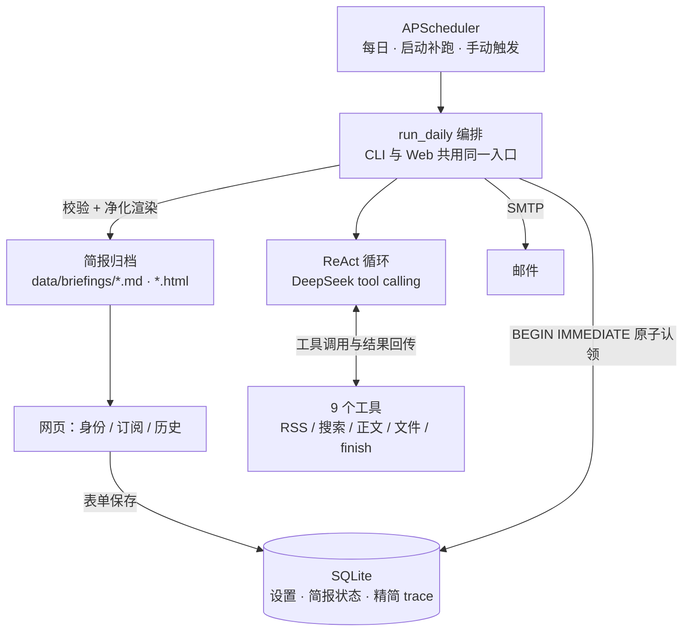

# ai-news-agent

[](https://github.com/TianJinYing2006/ai-news-agent/actions/workflows/ci.yml)


**每日 AI 新闻简报 Agent**：每天按设定时间，由大模型自主调用工具（RSS / 联网搜索 / 正文抓取），
边查、边筛、边写，生成一份当日 AI 新闻简报推送到邮箱。

核心设计点是**工具调用顺序完全由大模型决定**——不是"先抓完 RSS，再筛选，再总结"的固定流水线，
而是手写 ReAct 循环：模型发起工具调用、看到真实结果、再决定下一步（继续搜、换源、抓正文、还是结束）。

> 状态：本机 MVP 完成，含真实投递验收（2026-10-14）；159 项单测 + Ruff 全绿（CI 同款命令）。

## 亮点

- **顺序真由模型定**：用假 client 的受控测试证明"上一步工具结果改变了下一步选择"，
  而不是在 Python 里规定流程；真实 `trace` 只用于排障。
- **三道硬闸 + 原子防重**：`max_steps` / token 预算 / 连续重复调用检测，任一触发即失败记录，
  **绝不发"降级简报"**；SQLite `BEGIN IMMEDIATE` 原子认领，同一天并发触发只跑一个。
- **安全边界**：出网 SSRF 逐跳复查（拒 loopback / 私网 / link-local）、文件路径白名单、
  受限 `bash`（纯 Python 实现，不启动任意 shell）、Markdown 双重净化（禁原始 HTML + nh3 allowlist）。
- **可运维**：`--dry-run` 全链路演练（不发信不改状态）、轮转日志与退出码、启动补跑、
  网页可配推送时间与「立即运行一次」。
- **工程实践**：本仓库真实执行「一需求 = 一分支 = 一 PR = CLI 校验」，共 17 个 PR；CI 全绿。

## 60 秒本地体验（Windows）

1. 双击 **`start.cmd`** —— 自动创建虚拟环境、安装依赖、启动服务并打开浏览器（首次约 1–3 分钟）；
2. **没有 API key 也能逛**：另开一个终端执行
   `.venv\Scripts\python.exe -m news_agent.demo_seed`
   —— 历史页会出现两天带「演示数据」标记的简报（`--clean` 可清除）；
3. **接入真实推送**：配置 `DEEPSEEK_API_KEY` / `SMTP_USER` / `SMTP_PASS`（见下方"快速开始"），
   在网页填写身份与订阅，点「立即运行一次」即可完整跑通生成 → 归档 → 发信。

## 界面预览

三页均为服务端渲染的原生 HTML（FastAPI + Jinja2，无前端构建链、无前端路由）：

- **身份设置 / 订阅设置**：小表单直写 SQLite（话题、关键词、排除词、每天条数上限）；
- **历史简报**：推送时间设置 +「立即运行一次」+ 状态列表（失败原因可见）+ 每行「查看」；
- **简报详情**：归档 Markdown 经净化管线重新渲染，模型输出不直接进页面。

<!-- 截图建议（拍好后把图片放到 docs/images/，替换本注释为图片引用）：
     历史列表 + 调度控制卡
      简报详情页
           QQ 邮箱收件效果
-->

## 架构与数据流



一条主线：**网页配置偏好 → 调度触发 → 模型自主选工具产出简报 → 校验通过才落库归档并发信**；
失败保留错误与 trace，网页可见，重跑规则明确（SMTP 失败只重发、不重跑模型）。

## 为什么手写循环而不是用框架

不是因为框架做不到——LangGraph 的条件边同样可以依据模型响应中的 `tool_calls` 路由，
只要不预设"调哪个工具"，就仍是模型在选择动作。

选手写是因为**范围足够小**：单 Agent、单份消息历史、一组 function tools、一个循环和明确的成本上限。
这样"请求模型 → 执行它选的工具 → 回传结果 → 再请求模型"每一步都直接可见，
也便于适配 DeepSeek 的消息协议细节。若日后需要断点续跑、人工审批或多 Agent 协作，再评估框架。

## 工具集（9 个）

需求指定的 5 个原样保留，另加 4 个让"新闻助手"真正成立。

| 工具 | 作用 |
|---|---|
| `list_dir` / `read_file` / `write_file` | 工作区文件读写 |
| `search_content` | 目录内全文检索，返回**命中片段**而非整篇 |
| `bash` | 受限命令（`ls/cat/grep/wc/date/head/tail`），不启动任意 shell |
| `fetch_rss` | 抓取 RSS/Atom 源 |
| `search_web` | Tavily 联网搜索，供模型按需补搜 |
| `fetch_url` | 抽取网页正文（trafilatura） |
| `finish` | 宣告简报完成，是循环的唯一成功出口 |

**`send_email` 不在工具列表里。** 邮件是不可撤销的外部副作用，交给编排层在简报校验通过后执行；
模型只负责把简报写到文件然后喊停。

## 技术栈

| 层 | 选型 |
|---|---|
| 语言 | Python 3.13（包声明兼容 3.11+） |
| Agent 循环 | 手写 ReAct + OpenAI 兼容 SDK |
| LLM | DeepSeek `deepseek-flash`（原生 Tool Calls） |
| 搜索 | Tavily（可选） |
| 主新闻源 | RSS（9 个实测可用的国内源） |
| 存储 | SQLite（WAL，原子认领 + 陈旧租约回收） |
| Web | FastAPI + Jinja2，只监听 `127.0.0.1` |
| 推送 | SMTP（脚本自带，SSL/STARTTLS，重试可配置） |
| 调度 | APScheduler（进程内，随 FastAPI 启动） |

## 两个值得说明的设计取舍

**闭环而非一次性规划。** 两者的工具顺序都由模型决定，差别在于模型能否看见自己行为的后果。
RSS 源 404、正文是付费墙、今天内容特别少——这些情况下只有闭环能让模型自己换策略，
而不必由外围代码写兜底（兜底一写就变回硬编码）。

**跨运行记忆下沉到业务数据层。** 每次运行都是全新会话，不保存 `messages`；
偏好和简报状态存 SQLite，简报正文存文件供 `search_content` 检索。
这样会话恒定干净、可重放，也不会因为累积历史消息而让 token 成本线性上升。

## 如何验证"顺序真的由模型决定"

不靠"连跑几天看轨迹是否不同"——那依赖不可控的真实模型行为。

改用**受控测试**：用假 client 构造两条路径，一个工具结果导致模型选择搜索，
另一个结果导致模型直接结束；断言循环确实把结果回传、并把下一次工具选择交给模型，
而没有在 Python 里规定调用顺序。真实 trace 只用于排障。

## 快速开始（开发者）

不想配环境？直接双击 **`start.cmd`**（见上「60 秒本地体验」）。手动方式：

```bash
python -m venv .venv && ./.venv/Scripts/python.exe -m pip install -e ".[dev]"

# 凭据二选一（系统环境变量优先）：
#   A) Windows 用户级环境变量（推荐）：setx DEEPSEEK_API_KEY "..." 等
#   B) 项目 .env 兜底（已 gitignore）：cp .env.example .env 后填入

./.venv/Scripts/python.exe -m pytest -q                        # 单测（离线 mock，不联网）
./.venv/Scripts/python.exe -m news_agent.run_daily --dry-run   # 真链路演练：不发信、不改状态
./.venv/Scripts/python.exe -m news_agent.web                   # 网页 + 每日调度（仅本机）：http://127.0.0.1:8000
```

需要三个凭据：DeepSeek API key、Tavily key（可选）、QQ 邮箱 SMTP 授权码。
推荐用 `setx` 写入用户级环境变量（`DEEPSEEK_API_KEY` / `SMTP_USER` / `SMTP_PASS`，
可选 `TAVILY_API_KEY`）；缺少凭据时运行会给出明确错误，而不是静默降级。
收件邮箱不在环境变量里——在网页「身份」页填写。

## 每日运行与调度

- 业务唯一入口是 `python -m news_agent.run_daily`：原子认领 → 模型自主选工具 → 简报校验 →
  归档 `data/briefings/YYYY-MM-DD.md|.html` → SMTP 发送；同一天重复触发会跳过，
  SMTP 失败后的重跑**只重发邮件、不重跑模型**；
- 自动调度内置于 Web 服务：`python -m news_agent.web` 启动后，APScheduler 每天按推送时间自动调用 `run_daily()`
  - **推送时间**：默认 `.env` 的 `DAILY_RUN_AT`（07:00，Asia/Shanghai）；可在网页「历史简报」页修改
    （存 SQLite、保存即生效、优先于环境默认值）；
  - **启动补跑**：服务启动时若当天已过推送时间且未发送，立即补跑一次；**更早日期不补发**（错过很久就手动跑一次 CLI）；
  - **立即运行**：「历史简报」页按钮，后台排队执行；当天已发送 / 运行中会自动跳过（防重不变）；
  - 单进程单 worker、任务不重叠（`max_instances=1`）；SQLite 原子认领兜底防重；
- 日志写入 `data/logs/news_agent.log`（轮转）；CLI 成功退出码 0、失败 1。

## 当前进度

| 模块 | 状态 |
|---|---|
| 技术选型与实施计划 | ✅ `docs/` |
| 工具层 9 个 + 15 项单测 | ✅ |
| RSS 源清单（9 个可用 / 7 个已剔除并记录原因） | ✅ |
| 出网安全闸（SSRF 逐跳复查、超时、响应体上限） | ✅ |
| 存储层（原子认领、状态机、租约回收） | ✅ |
| Agent 循环（三道硬闸、错误回灌、脱敏 trace） | ✅ |
| 简报校验、渲染净化、SMTP 发送（重试可配置） | ✅ |
| 编排层与 CLI（dry-run、轮转日志、退出码） | ✅ |
| 前端三页（身份 / 订阅 / 历史简报） | ✅ |
| 进程内调度（启动补跑 / 网页可配时间 / 手动触发） | ✅ |
| 开箱即用（start.cmd 一键启动 / 演示数据 / CI 徽章） | ✅ |
| 全量单测与静态检查（159 项 / Ruff / GitHub Actions） | ✅ |
| 真实服务联调与首次正式投递 | ✅ 2026-10-14：tool-calling 两轮、SMTP 登录、dry-run（10 条/14 步）、正式投递（10 条/17 步/33 次工具调用，1 次尝试成功） |

## 文档

- `AGENTS.md` —— 协作工作流与硬性约束（一需求一分支一 PR、三道硬闸、安全红线）
- `docs/implementation-plan.md` —— 实施阶段、接口契约与验收标准（**以这份为准**）
- `docs/tech-stack-selection.md` —— 选型依据与关键设计论证
